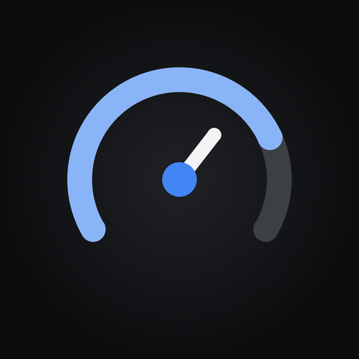
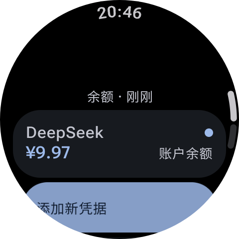
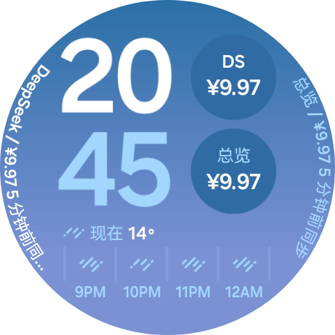
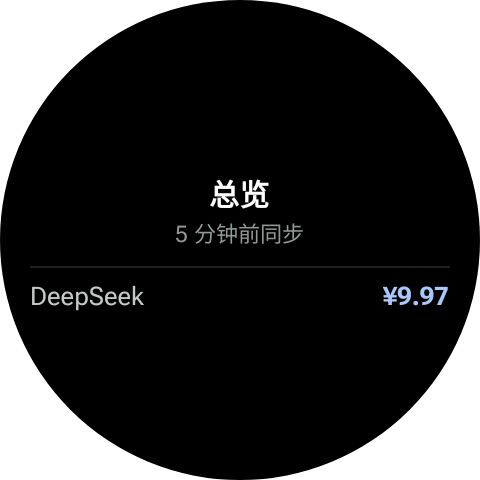

<p align="center">
  
</p>

<h1 align="center">余额表</h1>

<p align="center">在 Wear OS 上通过卡片和表盘组件查看 API 余额的小工具。</p>

## 效果

| 主页 | 表盘信息位 | 卡片（总览） |
| --- | --- | --- |
|  |  |  |

主页展示各厂商数值卡片；表盘信息位可分别显示不同厂商余额；卡片展示余额总览。

## 功能
- 同一厂商可添加多个凭据并分别管理各厂商凭据
- 软件首页展示数值卡片
- 适配圆形和条形表盘信息位，可分别展示不同厂商余额
- 支持添加卡片，可展示余额总览
- 可通过端到端加密将凭据安全存储至WebDAV服务器
## 支持的厂商

| 厂商 | 凭据 | 信息 | 接口 |
| --- | --- | --- | --- |
| OpenAI | 组织 Admin Key（`sk-admin`） | Token 用量、成本 | `/v1/organization/usage/completions`、`/v1/organization/costs` |
| Anthropic Claude | Admin API Key（`sk-ant-admin`） | Messages 用量 | `/v1/organizations/usage_report/messages` |
| 火山方舟 | AK / SK（V4 签名） | 推理用量 | `GetInferenceUsage` |
| 腾讯云 TokenHub | SecretId / SecretKey（TC3 签名） | 按 apikey / endpoint / model 的用量 | `DescribeUsageRankList` |
| DeepSeek | API Key | 余额 | `/user/balance` |
| Moonshot Kimi | API Key | 余额 | `/v1/users/me/balance` |

## 环境要求
Wear OS 3 / API 30 及以上，不兼容安卓

## 构建

```bash
./gradlew --no-daemon clean :app:testDebugUnitTest :app:assembleRelease :app:lintDebug
```

| 项 | 版本 |
| --- | --- |
| JDK | 17 |
| Gradle | 8.14.3 |
| AGP | 8.13.0 |
| Kotlin | 2.2.21 |
| compileSdk / targetSdk / minSdk | 36 / 36 / 30 |
| androidx.wear.compose | 1.6.2 |

产物：`app/build/outputs/apk/release/app-release.apk`（约 5.8 MB，R8 压缩）；单测 75 项。

`androidx.wear.compose` 钉在 1.6.2：1.7.x 要求 AGP 9.1 + compileSdk 37，与本工具链不兼容。

> 仓库路径含非 ASCII 字符时 AGP 会拒绝编译，需走 ASCII junction：
> `cmd /c mklink /J C:\dev\apimeter "<仓库路径>"`，并在 `local.properties` 中使用 junction 路径。

## 数据与隐私

- 不开启WebDAV时凭据仅存于本机，不经过任何中间服务器
- WebDAV使用26 字符的 Crockford Base32 经 scrypt(N=2¹⁴, r=8, p=1) 派生 256 bit 密钥，AES-256-GCM 加密并校验完整性，AAD 绑定信封元数据。`revision` 单调递增防回滚，`ETag` + `If-Match` 防并发覆盖
- 本地凭据密文存储保存于 DataStore，密钥保存于 Android Keystore；恢复码只存在于内存与 Keystore 加密的本地副本。
- 当前版本无遥测、无统计、无崩溃上报

## 许可证

本项目基于 [MIT License](LICENSE) 开源。

---

<p align="center">
  <a href="https://github.com/deepseek-ai/deepseek-harness">
    
  </a>
</p>